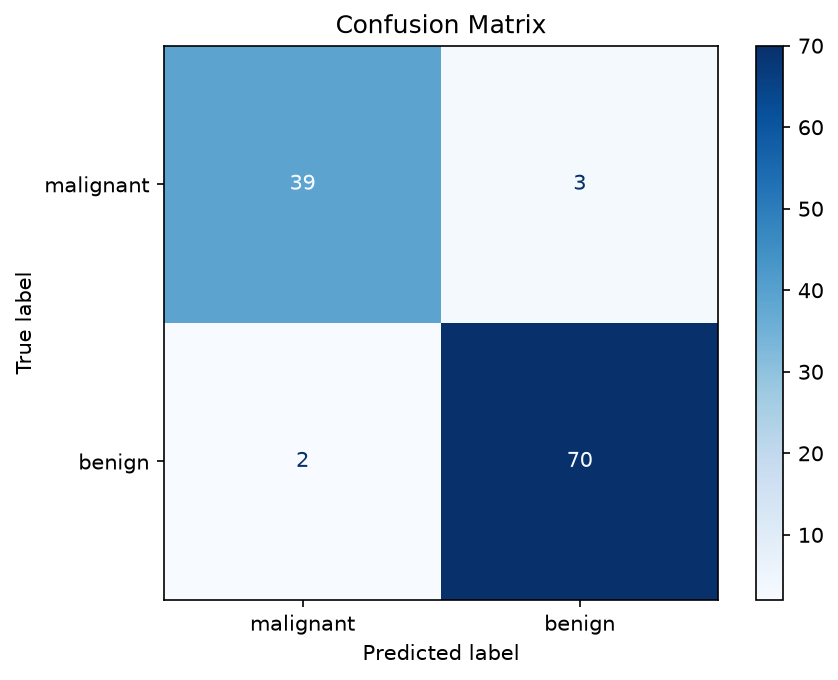
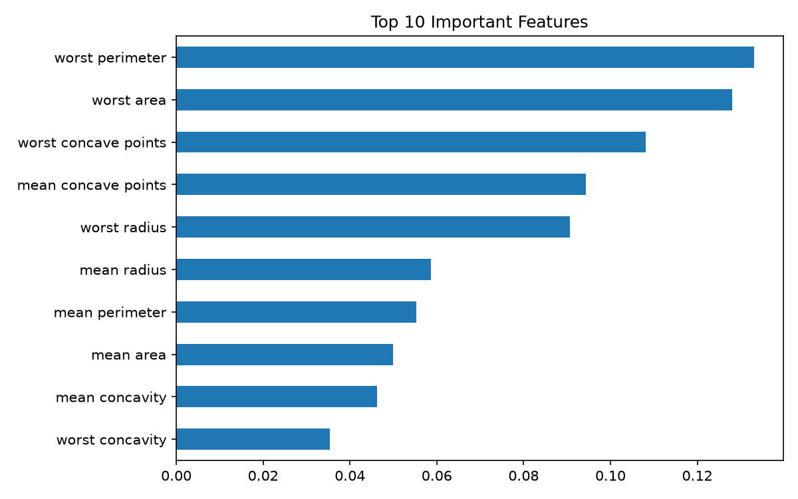

# Breast Cancer Prediction using Machine Learning

A machine learning project that predicts whether a breast tumor is **benign** or **malignant** from cell measurements, with an interactive web app built in Streamlit.

**Live demo:** https://breast-cancer-prediction-ss.streamlit.app/

> Educational project only. This is not a medical diagnosis tool.

## Overview

The model is trained on the Wisconsin Diagnostic Breast Cancer dataset (569 patients, 30 features). Each feature is a measurement of the cell nuclei in a digitized image of a fine needle aspirate, such as radius, texture, area, smoothness, and concavity.

## Results

| Metric | Value |
|---|---|
| Test accuracy | 95.6% |
| 5-fold cross-validation accuracy | 95.8% |
| Malignant recall | 0.93 |
| Benign recall | 0.97 |

Most important features: worst perimeter, worst area, and worst concave points.




## How it works

1. Load the dataset from scikit-learn.
2. Split the data 80% training and 20% testing (stratified).
3. Train a Random Forest classifier with 200 trees.
4. Evaluate with accuracy, cross-validation, a classification report, and a confusion matrix.
5. Serve predictions through a Streamlit web app.

## Web app features

- **Quick predict:** adjust sliders for the 10 most important features.
- **Enter all 30 values:** type in every measurement for a single patient.
- **Upload CSV:** predict many patients at once and download the results.

## Run locally

```
git clone https://github.com/shanmathisundarrajan/breast-cancer-prediction.git
cd breast-cancer-prediction
pip install -r requirements.txt
python -m streamlit run app.py
```

## Project files

| File | Purpose |
|---|---|
| `app.py` | Streamlit web app |
| `breast_cancer_prediction.py` | Training and evaluation script |
| `requirements.txt` | Libraries needed to run the app |

## Tech stack

Python, scikit-learn, pandas, NumPy, Matplotlib, Streamlit

## Disclaimer

This project is for learning purposes. The model was trained on a small public dataset and must not be used for real medical decisions.
